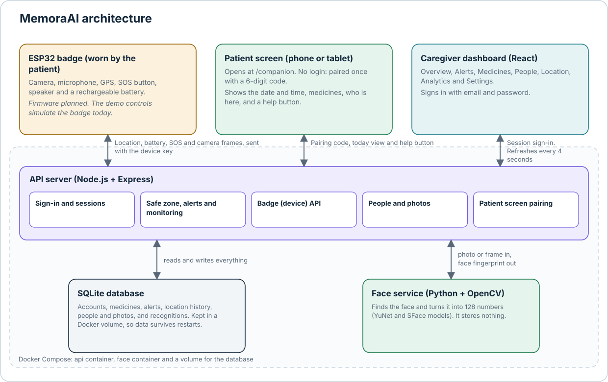
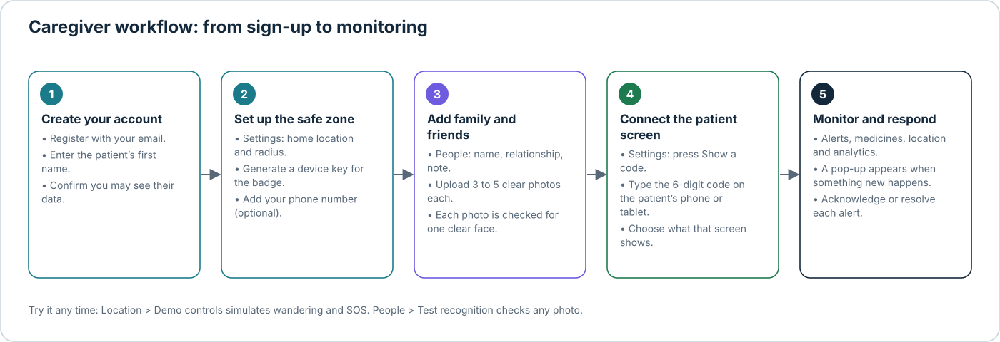
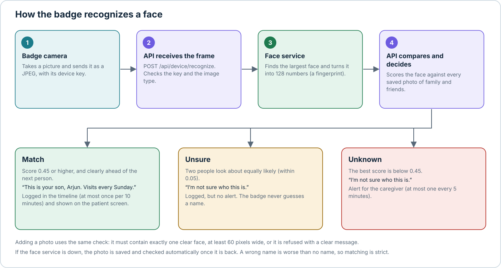
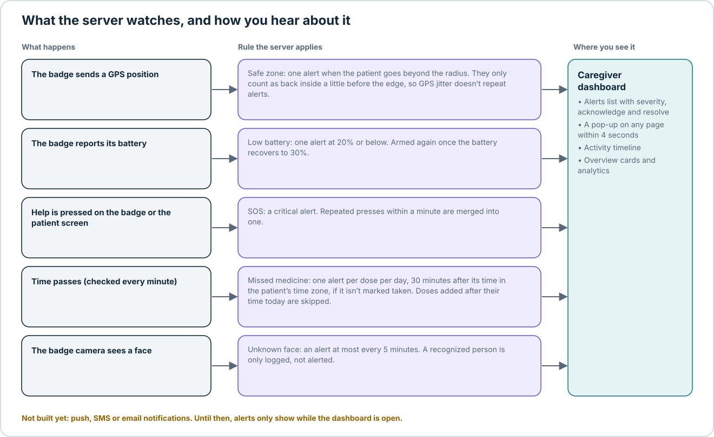

# MemoraAI

**AI-driven cognitive and safety assistance for Alzheimer's patients.** *When memory fades, guidance remains.*

MemoraAI is a wearable badge plus a caregiver web app. The badge recognizes familiar faces and speaks who they are, reminds the patient about medicines, tracks location against a safe zone, and has an SOS button. Caregivers see everything on a dashboard and get alerts. The patient gets a simple, calm screen of their own.

> **Academic prototype** by Group ECE-13, Department of Electronics & Telecommunication Engineering, Modern College of Engineering, Pune. It is not a medical device. Medicine names and doses in the demo data are samples. Always follow the doctor's prescription.



## Contents

- [What works today](#what-works-today)
- [Quick start](#quick-start)
- [How a caregiver uses it](#how-a-caregiver-uses-it)
- [Face recognition](#face-recognition)
- [Alerts and monitoring](#alerts-and-monitoring)
- [Patient screen](#patient-screen-companion-mode)
- [Badge API](#badge-api)
- [Project structure](#project-structure)
- [Configuration](#configuration)
- [Database](#database)
- [Security](#security)
- [Development tips](#development-tips)
- [Troubleshooting](#troubleshooting)
- [Known limits and roadmap](#known-limits-and-roadmap)

## What works today

| Area | What it does |
|---|---|
| Accounts | Register, sign in, sign out, session cookie, passwords stored as bcrypt hashes, lockout messaging |
| Dashboard | Overview, Alerts, Medicines, People, Location, Analytics, Settings |
| Safe zone | Home location and radius per caregiver. One alert when the patient leaves, checked on the server |
| Medicines | Schedule, mark taken, missed-dose alerts in the patient's time zone |
| Face recognition | Family and friends with photos. Strict matching. The badge gets a sentence to speak |
| Patient screen | Date and time, medicines, who is here, "Take me home", "Call my caregiver", "I need help" |
| Badge API | Location, battery, SOS, camera frames and the medicine schedule, with a per-badge key |
| Storage | SQLite in a Docker volume. Data survives restarts |

## Quick start

**You need:** [Docker Desktop](https://www.docker.com/products/docker-desktop/) and [Node.js](https://nodejs.org/) 18 or newer.

```bash
# 1. Secrets
cp .env.example .env
openssl rand -hex 32        # paste the output after JWT_SECRET= in .env

# 2. Backend, database and face service (first build downloads about 40 MB of face models)
docker compose up --build

# 3. Frontend, in a second terminal
cd frontend
npm install
npm run dev
```

Open <http://localhost:5173>. Sign in with the demo caregiver, or register your own:

```
caregiver@memoraai.demo
Memora@123
```

| Service | Address |
|---|---|
| Web app | <http://localhost:5173> |
| API | <http://localhost:4000/api/health> |
| Face service | <http://localhost:8000/health> (only reachable from your own computer) |

Stop with `Ctrl+C`, then `docker compose down`. Your data is kept. `docker compose down -v` deletes the database as well.

## How a caregiver uses it



1. **Create an account.** Enter your name, the patient's first name, and confirm you are allowed to see their data.
2. **Set up the safe zone.** In **Settings**, set the home location (or press *Use my current location*) and a radius. Generate a **device key** for the badge. The key is shown once.
3. **Add family and friends.** In **People**, add each person's name, how they are related ("son", "friend") and an optional note. Upload 3 to 5 clear photos of just that person. Each photo must contain exactly one clear face.
4. **Connect the patient screen.** In **Settings**, press *Show a code* and type the 6-digit code on the patient's phone or tablet at `/companion`.
5. **Monitor and respond.** Watch alerts, medicines and location. A pop-up appears when something new happens. Acknowledge or resolve each alert.

**Try it without hardware.** *Location > Demo controls* simulates the patient wandering out of the safe zone and pressing SOS. These readings go through the same server code as the real badge. *People > Test recognition* shows who the system thinks is in any photo, with a score per person.

## Face recognition



Two containers cooperate. The **face service** (Python and OpenCV) turns a photo into a 128-number fingerprint using the YuNet face detector and the SFace recognizer. It stores nothing. The **API** (Node) stores fingerprints with each photo in SQLite and does the matching.

- **Strict on purpose.** A wrong name is worse than no name for someone with Alzheimer's. A face counts as a match only if its score is at least `0.45` *and* it is clearly ahead of the next person (by `0.05`). Otherwise the badge says "I'm not sure who this is."
- **Spoken sentence.** For a match: "This is your son, Arjun. Visits every Sunday." The relationship and note come from the People page.
- **No flooding.** A known person is logged at most once every 10 minutes. Unknown faces raise at most one alert every 5 minutes.
- **If the face service is down,** photos are still saved. They show "Checking" and are verified automatically once the service is back.

**Tuning the threshold.** Use *Test recognition* with photos you have not uploaded. A different photo of the same person should score above the threshold. A different person should score well below it. If real matches fall short, lower `MATCH_THRESHOLD` in `.env` a little (OpenCV suggests 0.363 as a general-purpose value). If different people ever match, raise it. Then run `docker compose up -d`.

**Check the service:**

```bash
docker compose logs face                              # should end with "Uvicorn running on http://0.0.0.0:8000"
docker compose cp photo.jpg face:/tmp/photo.jpg
docker compose exec face python selftest.py /tmp/photo.jpg
```

## Alerts and monitoring



All rules run on the **server**, not in the browser, so alerts are created even when the dashboard is closed.

| Alert | Rule |
|---|---|
| Left safe zone | One alert when the patient goes beyond the radius. They count as back inside a little before the edge, so GPS jitter doesn't repeat alerts |
| Low battery | One alert at 20% or below. Armed again once the battery recovers to 30% |
| SOS | Critical alert. Repeated presses within a minute are merged |
| Missed medicine | One alert per dose per day, 30 minutes after its time in the patient's time zone, if it isn't marked taken. Doses added after their time today are skipped |
| Unknown person | At most one alert every 5 minutes |

The dashboard refreshes every 4 seconds and shows a pop-up for new alerts. **Push, SMS and email notifications are not built yet**, so alerts are only seen while the dashboard is open.

## Patient screen (companion mode)

A simple screen for the patient at `/companion`: a greeting, the date and a large clock, medicines to take, who is visiting, "Take me home" (walking directions in the maps app), "Call my caregiver", and "I need help". It uses large text, calm wording and no countdowns.

- **Pairing.** The caregiver shows a 6-digit code in Settings. It works once and expires in 10 minutes. After entering it, the screen needs no login. The caregiver can disconnect any screen at any time.
- **Safe by design.** The screen shows no alerts, settings, location history or analytics. It can only confirm a medicine and ask for help. A dose already taken today cannot be confirmed again, so there is no double dose. Repeated help presses within a minute send one alert. Patient confirmations appear in the timeline as "confirmed by patient".
- **Caregiver control.** In Settings, choose which sections appear, and add a phone number for the "Call my caregiver" button. Switched-off sections are not sent to the screen at all.
- **On a phone or tablet.** On the same Wi-Fi, open `http://<your-computer-ip>:5173/companion`. The dev server listens on your network for this (`host: true` in `frontend/vite.config.js`). Use a trusted network.

## Badge API

The badge sends requests to `http://<computer-ip>:4000/api/device/...` with the header `X-Device-Key: <key from Settings>`. Limit: 120 requests per minute per key.

| Request | Body | What it does |
|---|---|---|
| `POST /api/device/telemetry` | JSON `{ "lat", "lng", "battery" }` | Saves the position, checks the safe zone, records the battery |
| `POST /api/device/sos` | none | Raises a critical SOS alert |
| `POST /api/device/recognize` | raw JPEG or PNG bytes | Identifies the largest face. Returns `{ status, speech, person, score, logged }` |
| `POST /api/device/face` | JSON `{ "recognized", "name", "relationship" }` | Logs a face the badge identified itself, or alerts on an unknown one |
| `GET /api/device/schedule` | none | The medicine schedule, so the badge can speak reminders |


The default home location is a placeholder in Pune. Set the real one in Settings first, or the safe-zone check will compare against the wrong place.


## Database

SQLite lives in the Docker volume `memoraai-data` (file `/data/memoraai.db` in the `api` container). Tables are created and upgraded automatically on start.

| Table | Holds |
|---|---|
| `users` | Caregiver accounts and the patient's name. Password hashes only |
| `settings` | Home location, radius, time zone, patient-screen options, alert state |
| `devices` | The badge: hash of its key, last seen, battery |
| `medicines`, `medicine_logs`, `medicine_alerts` | Schedule, each dose marked taken (by caregiver or patient), one missed-dose alert per day |
| `alerts` | All alerts with severity and status |
| `locations` | GPS history (latest 2000 points per caregiver) |
| `activity` | The dashboard timeline |
| `people`, `person_photos` | Family and friends, and up to 5 photos each with a face fingerprint |
| `recognitions` | Every face the badge recognized or didn't, with score and time |
| `companion_sessions`, `pair_codes` | Paired patient screens (hashed tokens) and short-lived pairing codes |

**Back up** (copies the whole data folder, including write-ahead files):

```bash
docker compose stop api
docker compose cp api:/data ./backup-data
docker compose start api
```

## Security

- Passwords: bcrypt. Sessions: signed token in an `httpOnly` cookie. Login and registration are rate limited.
- Each caregiver can only read and change their own data. This is checked on every request.
- Badge keys, patient-screen tokens and pairing codes are stored only as hashes. The badge key is shown once.
- The patient screen has its own limited session. It can never read alerts, settings or location history.
- Photos are checked by their actual file contents, not their extension. GIF and SVG files are refused.
- The face service is not exposed to the network. It listens on `127.0.0.1` for debugging only.
- Responses carry security headers (`helmet`).

**Before using it for real:** serve everything over HTTPS and set `COOKIE_SECURE` to `"true"`, set `SEED_DEMO=false`, use a strong `JWT_SECRET`, and back up the volume.

## Development tips

**No rebuild after every change.** Backend and face-service code changes are copied into the running containers, which restart automatically:

```bash
docker compose -f docker-compose.yml -f docker-compose.watch.yml watch
```

This needs Docker Compose 2.22 or newer (`docker compose version`). Changes to `server/package.json` or `face/requirements.txt` trigger a rebuild. Without watch mode, run `docker compose up --build` after backend changes.

## Troubleshooting

| Symptom | Likely cause and fix |
|---|---|
| "Not found." on the dashboard or People page | The running API container is older than your code. Run `docker compose down`, then `docker compose up --build`. Check with `curl -i http://localhost:4000/api/people`: `401` means the new API is running, `404` means it isn't |
| "Couldn't load the dashboard" or "Can't reach the server" | The backend isn't running. Start it with `docker compose up` and check `docker compose ps` |
| `docker compose up` says `JWT_SECRET` is not set | You haven't created `.env`. Run `cp .env.example .env` and set the secret |
| Face image fails to build (model download) | Check your internet connection and retry. You can run the rest without it: `docker compose up --build api` |
| Photos stay on "Checking…" | The face service isn't running. See `docker compose logs face` |
| "The face is too small" or "No face found" | Use a closer, front-facing photo with only that person in it |
| A real person scores below the threshold | Add more photos (3 to 5, different angles and light). Then, if needed, lower `MATCH_THRESHOLD` slightly |
| The patient screen won't open on a phone | The phone must be on the same Wi-Fi. Use your computer's IP address (not `localhost`) and allow the connection in your firewall |
| Port 4000, 5173 or 8000 already in use | Stop the other program using it, or change the port mapping in `docker-compose.yml` |


**Good to know:** the face service needs about 40 MB of model files, downloaded when the image is built. Face matching quality depends on photo quality, so add several clear photos per person.

---
